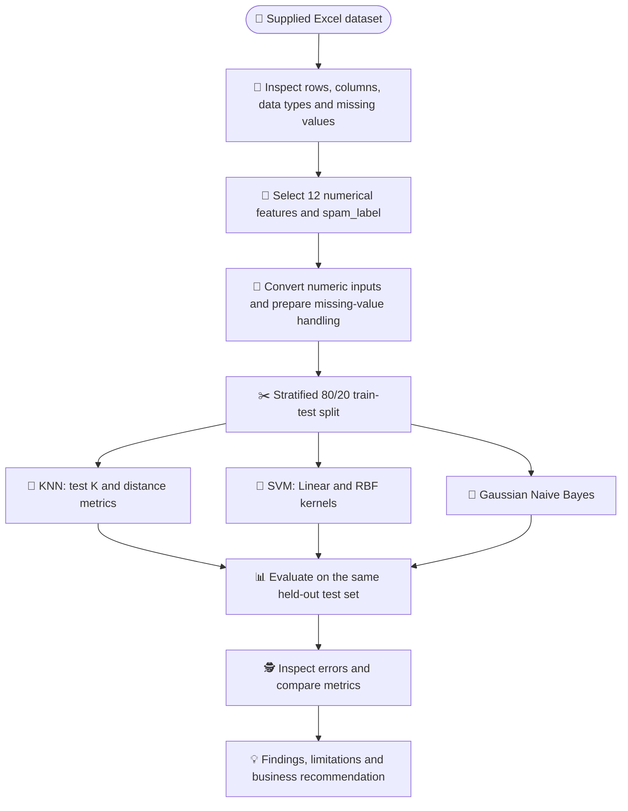
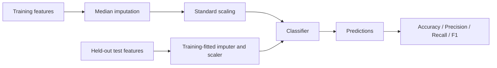
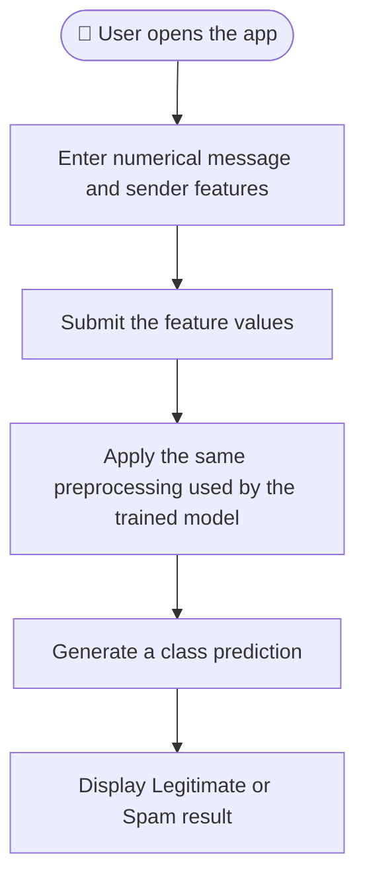

# 📩 Message Intelligence System

### A Supervised Machine Learning Project for Spam Detection

**Turning message signals into actionable classification insights**

[](https://www.python.org/)
[](https://jupyter.org/)
[](https://scikit-learn.org/)
[](https://pandas.pydata.org/)
[]()

**Author: Dushyant V**\
**Project:** PR.4 --- Message Intelligence System\
**Track:** Supervised Learning

---

## 👋 About this project

Every day, people receive a mixture of useful messages and unwanted
spam. Sorting those messages manually is inconvenient and does not scale
particularly well. This project explores how supervised machine learning
can help classify a message as either **legitimate** or **spam** using
numerical message characteristics and sender-behaviour signals.

I built this project as an end-to-end classification exercise: starting
with the supplied dataset, preparing the features, training multiple
algorithms, comparing their predictions, and translating the results
into a practical business recommendation.

The goal was not simply to obtain a high score. I also wanted to
understand **why the models make predictions, how their approaches
differ, and what should be checked before using a model in a real
communication-security workflow.**

> **Project scope:** This notebook uses engineered numerical features
> supplied in the dataset. It does not train a text/NLP model directly
> on the raw message content.

## 🧭 Table of contents

-   [🎯 Objective](#-objective)
-   [🧩 Problem definition](#-problem-definition)
-   [📊 Dataset overview](#-dataset-overview)
-   [🛠️ Tools and technologies](#️-tools-and-technologies)
-   [🔄 End-to-end workflow](#-end-to-end-workflow)
-   [🧠 Machine learning models](#-machine-learning-models)
-   [⚙️ Methodology](#️-methodology)
-   [📈 Evaluation and results](#-evaluation-and-results)
-   [🎲 Probability: Bayes' theorem
    example](#-probability-bayes-theorem-example)
-   [💻 Run the project](#-run-the-project)
-   [🧪 Example code](#-example-code)
-   [🖥️ Streamlit application](#️-streamlit-application)
-   [📁 Repository structure](#-repository-structure)
-   [⚠️ Limitations and responsible
    use](#️-limitations-and-responsible-use)
-   [🚀 Future improvements](#-future-improvements)
-   [📦 Deliverables](#-deliverables)
-   [👨‍💻 Author](#-author)

------------------------------------------------------------------------

## 🎯 Objective

Build and compare supervised learning classifiers that predict whether a
message is:

   Label  Meaning
  ------- -----------------------
    `0`   ✅ Legitimate message
    `1`   🚨 Spam message

The project focuses on three classifier families required by the project
brief:

1.  **Distance-based:** K-Nearest Neighbors (KNN)
2.  **Margin-based:** Support Vector Machine (SVM), using Linear and RBF
    kernels
3.  **Probabilistic:** Gaussian Naive Bayes

The models are compared using accuracy, precision, recall, and F1 score.

## 🧩 Problem definition

A communication-security team wants to identify potentially unwanted
messages using measurable characteristics of the message and its sender.

This notebook treats spam detection as a **binary classification**
problem:

-   **Inputs (`X`):** 12 numerical message, sender, and time-related
    features.
-   **Target (`y`):** `spam_label`.
-   **Output:** predicted class --- legitimate (`0`) or spam (`1`).

The `message_id` field is an identifier, not a useful behavioural
signal, so it is excluded. The raw `message_text` and `timestamp` are
also excluded from this experiment; the project uses the dataset's
engineered numerical features, including `hour_of_day` and
`day_of_week`.

## 📊 Dataset overview

The supplied Excel dataset contains **5,200 rows and 16 columns**.

### Target distribution

  Class                  Records      Share
  ------------------ ----------- ----------
  Legitimate (`0`)         4,227      81.3%
  Spam (`1`)                 973      18.7%
  **Total**            **5,200**   **100%**

The classes are not equally represented. This is one reason the notebook
reports precision, recall, and F1 score rather than relying on accuracy
alone.

### Input features used

  -----------------------------------------------------------------------
  Feature                             What it represents
  ----------------------------------- -----------------------------------
  `message_length`                    Message length

  `word_count`                        Number of words

  `num_urls`                          Number of URLs

  `num_digits`                        Number of digits

  `num_special_chars`                 Number of special characters

  `spam_keyword_score`                Spam-keyword frequency score

  `legit_keyword_score`               Legitimate-keyword frequency score

  `sender_activity_score`             Sender activity signal

  `sender_account_age_days`           Sender account age in days

  `messages_sent_last_24h`            Messages sent by the sender in the
                                      last 24 hours

  `hour_of_day`                       Hour associated with the message

  `day_of_week`                       Day-of-week feature
  -----------------------------------------------------------------------

### Missing-value handling

The supplied dataset has missing values in three selected features:

  Feature                       Missing values
  --------------------------- ----------------
  `sender_activity_score`                  106
  `sender_account_age_days`                113
  `messages_sent_last_24h`                 162

The notebook uses **median imputation** within scikit-learn pipelines.
This is important because the imputer is fitted on the training data
rather than learning preprocessing values from the held-out test data.

## 🛠️ Tools and technologies

  Tool / library         How it is used
  ---------------------- -----------------------------------------------
  Python                 Main programming language
  Jupyter Notebook       Step-by-step experimentation and explanation
  Pandas                 Loading and inspecting the Excel dataset
  NumPy                  Numerical operations
  Matplotlib             Charts and visual evaluation
  scikit-learn           Preprocessing, model training, and evaluation
  `train_test_split`     Training/testing split
  `Pipeline`             Keeps preprocessing and model steps together
  `SimpleImputer`        Handles missing numerical values
  `StandardScaler`       Scales numerical features
  KNN, SVC, GaussianNB   Classification algorithms

## 🔄 End-to-end workflow

The project follows a clear machine learning workflow:



### Preprocessing and evaluation logic



The train/test split uses `stratify=y` to preserve approximately the
same class proportions in both sets. The split is 80% training and 20%
testing, with `random_state=42` for reproducibility.

## 🧠 Machine learning models

### 1. 📍 K-Nearest Neighbors (KNN)

KNN predicts the class of a new example by looking at the labels of its
nearest training examples.

-   Tested `K` values: **3, 5, 7, 9, 11**
-   Tested distance metrics: **Euclidean** and **Manhattan**
-   Applied median imputation and standard scaling in a pipeline.
-   Selected the configuration with the highest test-set F1 score.

**Why it is useful:** KNN is intuitive and makes the idea of
similarity-based classification easy to demonstrate.

**Trade-off:** Distance calculations can become slower as the training
dataset grows, and the result can depend on feature scaling and the
choice of `K` and distance metric.

### 2. 📐 Support Vector Machine (SVM)

SVM learns a decision boundary that separates the classes while seeking
a large margin.

  Kernel   What it does
  -------- ----------------------------------------------------
  Linear   Uses a linear decision boundary
  RBF      Can represent more flexible, non-linear boundaries

The notebook compares both kernels and inspects the number of support
vectors learned by each fitted SVM.

**Why it is useful:** SVM can create effective class boundaries and the
RBF kernel can model more complex separation.

**Trade-off:** Scaling and parameter selection matter. SVM can also be
less straightforward to explain than a simple neighbour-based model.

### 3. 🎲 Gaussian Naive Bayes

Naive Bayes applies Bayes' theorem to estimate class probabilities.
Gaussian Naive Bayes models numerical features using a Gaussian
distribution within each class.

**Key assumption:** Features are treated as conditionally independent
given the class. This is a simplifying assumption and may not fully
reflect relationships between real message features.

**Why it is useful:** It is a fast probabilistic baseline and provides
class-probability estimates.

## ⚙️ Methodology

The notebook is organised so a reviewer can follow the experiment from
beginning to end:

1.  Import the required libraries.
2.  Load the supplied Excel dataset.
3.  Inspect the dataset structure, data types, missing values, and
    target distribution.
4.  Define the 12 input features and the `spam_label` target.
5.  Convert feature values to numeric form and handle missing values in
    pipelines.
6.  Create a stratified 80/20 train-test split.
7.  Train and compare KNN configurations.
8.  Train Linear and RBF SVM models.
9.  Train Gaussian Naive Bayes.
10. Demonstrate a manual Bayes' theorem calculation.
11. Compare models with common classification metrics.
12. Inspect KNN misclassifications and write a business recommendation.

## 📈 Evaluation and results

All models are evaluated on the same held-out test set of **1,040
records**: 845 legitimate messages and 195 spam messages.

### Results from the executed notebook

  Model                            Accuracy   Precision   Recall   F1 score
  ------------------------------ ---------- ----------- -------- ----------
  KNN (selected configuration)        1.000       1.000    1.000      1.000
  SVM --- Linear                      1.000       1.000    1.000      1.000
  SVM --- RBF                         1.000       1.000    1.000      1.000
  Gaussian Naive Bayes                1.000       1.000    1.000      1.000

The selected KNN configuration was **K = 3 with Euclidean distance**.
The KNN search also tested other values and Manhattan distance; several
configurations achieved the same displayed F1 score.

> **Important interpretation:** All four models achieved perfect
> displayed metrics on this particular test split. This is an
> observation about this dataset and split, not proof that the models
> will be perfect on future or real-world messages. Because the scores
> are tied, this experiment does not establish that one classifier is
> universally better than the others.

### What do the metrics mean?

  -----------------------------------------------------------------------
  Metric                  Question it answers     Why it matters for spam
                                                  detection
  ----------------------- ----------------------- -----------------------
  Accuracy                What proportion of all  Gives an overall view,
                          predictions were        but can hide
                          correct?                class-specific errors.

  Precision               Of the messages         Helps limit legitimate
                          predicted as spam, how  messages being flagged
                          many were spam?         as spam.

  Recall                  Of all actual spam      Helps reduce spam
                          messages, how many were messages that pass
                          caught?                 through.

  F1 score                What is the balance     Useful when both types
                          between precision and   of error matter.
                          recall?                 
  -----------------------------------------------------------------------

### Confusion matrix and error review

The notebook generates confusion matrices for the classifiers and checks
the selected KNN model for mismatches between actual and predicted
labels.

In the executed run, KNN reported **0 misclassified test records**.
Consequently, there were no KNN error examples to inspect in this split.

For a deployed system, the two error types deserve separate attention:

-   **False positive:** a legitimate message is predicted as spam.
-   **False negative:** a spam message is predicted as legitimate.

The business should decide which error is more costly before selecting a
model or decision threshold.

## 🎲 Probability: Bayes' theorem example

The notebook includes a small manual probability calculation using
observed dataset counts.

Define:

-   **A:** `spam_keyword_score > 0`
-   **B:** the message is labelled spam

Bayes' theorem:

\[ P(B`\mid `{=tex}A)=`\frac{P(A\mid B)\times P(B)}{P(A)}`{=tex} \]

Observed values from the supplied dataset:

  Probability              Observed value
  ---------------------- ----------------
  (P(A))                           0.1433
  (P(B))                           0.1871
  (P(A`\mid `{=tex}B))             0.7657
  (P(B`\mid `{=tex}A))             1.0000

For this dataset, every record with a positive spam-keyword score is
labelled as spam, so the direct count-based check also gives 1.0000.

**A useful distinction:** This manual calculation uses one binary event
derived from one feature. Gaussian Naive Bayes uses all selected
numerical features and its Gaussian distribution assumptions. The two
probabilities are therefore not expected to be identical for an
arbitrary message.

## 💻 Run the project

### 1. Clone the repository

``` bash
git clone <your-github-repository-url>
cd <your-repository-folder>
```

Replace the placeholders with your actual GitHub repository URL and
folder name.

### 2. Create and activate a virtual environment (recommended)

**Windows:**

``` bash
python -m venv .venv
.venv\Scripts\activate
```

**macOS / Linux:**

``` bash
python3 -m venv .venv
source .venv/bin/activate
```

### 3. Install dependencies

If a `requirements.txt` file is included in the repository:

``` bash
pip install -r requirements.txt
```

Otherwise, install the notebook's core libraries:

``` bash
pip install pandas numpy matplotlib scikit-learn openpyxl jupyter
```

For the Streamlit interface, install Streamlit as well:

``` bash
pip install streamlit
```

### 4. Keep the dataset beside the notebook

The notebook expects the file:

``` text
Message_Intelligence_Dataset_5200(1).xlsx
```

Keep the Excel file in the same directory as the notebook. In Google
Colab, the notebook includes an upload fallback if the file is not
found.

### 5. Launch Jupyter

``` bash
jupyter notebook
```

Open `Message_Intelligence_System_Project.ipynb` and run the cells from
top to bottom.

**Reproducibility note:** The notebook uses `random_state=42` for its
train/test split. Your results can differ if you change the dataset,
features, preprocessing, or model settings.

## 🧪 Example code

These short examples show the main patterns used in the notebook.

### Load and inspect the dataset

``` python
import pandas as pd

df = pd.read_excel("Message_Intelligence_Dataset_5200(1).xlsx")

print("Dataset shape:", df.shape)
display(df.head())
print(df["spam_label"].value_counts())
```

### Select model inputs and target

``` python
feature_cols = [
    "message_length", "word_count", "num_urls", "num_digits",
    "num_special_chars", "spam_keyword_score", "legit_keyword_score",
    "sender_activity_score", "sender_account_age_days",
    "messages_sent_last_24h", "hour_of_day", "day_of_week"
]

X = df[feature_cols].apply(pd.to_numeric, errors="coerce")
y = df["spam_label"].astype(int)
```

### Split the data

``` python
from sklearn.model_selection import train_test_split

X_train, X_test, y_train, y_test = train_test_split(
    X,
    y,
    test_size=0.20,
    random_state=42,
    stratify=y
)
```

### Build a KNN pipeline

``` python
from sklearn.pipeline import Pipeline
from sklearn.impute import SimpleImputer
from sklearn.preprocessing import StandardScaler
from sklearn.neighbors import KNeighborsClassifier

knn_model = Pipeline([
    ("imputer", SimpleImputer(strategy="median")),
    ("scaler", StandardScaler()),
    ("knn", KNeighborsClassifier(
        n_neighbors=3,
        metric="euclidean"
    ))
])

knn_model.fit(X_train, y_train)
knn_predictions = knn_model.predict(X_test)
```

### Evaluate predictions

``` python
from sklearn.metrics import (
    accuracy_score,
    precision_score,
    recall_score,
    f1_score
)

print("Accuracy:", accuracy_score(y_test, knn_predictions))
print("Precision:", precision_score(y_test, knn_predictions))
print("Recall:", recall_score(y_test, knn_predictions))
print("F1 score:", f1_score(y_test, knn_predictions))
```

These are illustrative excerpts from the notebook's workflow. The
complete notebook contains the full experiments, plots, classification
reports, confusion matrices, and interpretations.

## 🖥️ Streamlit application

A Streamlit interface is part of the project deliverables described in
the project brief. The intended user flow is:



The interface is intended to demonstrate how a trained classifier could
be presented to a non-technical user.

**Current scope:** The notebook works with engineered numerical
features. The app should receive the same 12 model inputs and use a
model trained and saved from the notebook. It is not a raw-text spam
detector.

To run an included `app.py` file, install the dependencies and use:

``` bash
streamlit run app.py
```

If the app file or a saved model artifact is not present in the
repository yet, add and test those deliverables before describing the
app as deployed or sharing a live URL.

**Live application:** *Add the verified Streamlit deployment URL here
after deployment.*

## 📁 Repository structure

A clean repository for this project can follow this structure:

``` text
message-intelligence-system/
│
├── Message_Intelligence_System_Project.ipynb
├── Message_Intelligence_Dataset_5200(1).xlsx
├── app.py
├── requirements.txt
├── README.md
│
├── docs/
│   └── Message_Intelligence_Theory_Guide.pdf
│
├── screenshots/
│   ├── target_distribution.png
│   ├── knn_confusion_matrix.png
│   ├── svm_confusion_matrices.png
│   └── model_comparison.png
│
└── presentation/
    └── project_presentation_link.txt
```

Only include files and folders that actually exist in your repository.
The screenshot and presentation folders are suggested organisation for
the supporting evidence required by the project brief.

## ⚠️ Limitations and responsible use

A strong test score is encouraging, but it is not enough on its own to
justify a production deployment.

1.  **Engineered features only:** The models use numerical summaries and
    sender/time signals, not raw message text. This is not a complete
    natural-language spam detection system.
2.  **One held-out split:** The reported results come from one
    stratified 80/20 split. Performance should be checked on new,
    independently collected data.
3.  **Perfect displayed scores need investigation:** All four models
    scored 1.000 on this test split. This may reflect strong separation
    in the supplied engineered features. It should prompt additional
    checks for target leakage, feature-generation leakage, duplicated
    patterns, and representativeness---not an assumption of perfect
    real-world performance.
4.  **Class distribution:** Around 18.7% of records are spam. Accuracy
    should be interpreted alongside precision, recall, and F1.
5.  **Feature availability:** A real application needs a reliable and
    consistent way to calculate all 12 features for each incoming
    message.
6.  **Changing behaviour:** Spam patterns can change. A deployed model
    needs monitoring and periodic evaluation.
7.  **User impact:** False positives can hide legitimate communications;
    false negatives can allow spam through. Thresholds and review
    policies should reflect the business context.

## 🚀 Future improvements

The next steps I would prioritise are:

-   Evaluate the models on a fresh, independently collected dataset.
-   Investigate possible feature or target leakage and inspect how the
    engineered features were created.
-   Add cross-validation and systematic hyperparameter tuning.
-   Review precision-recall trade-offs and select a decision threshold
    based on business costs.
-   Add a raw-text feature extraction and NLP pipeline as a separate
    extension.
-   Save the complete preprocessing-and-model pipeline so the app uses
    exactly the same transformations as training.
-   Monitor prediction quality, false positives, false negatives, and
    data drift after deployment.

## 📦 Deliverables

The project brief requests the following submission items:

  ----------------------------------------------------------------------------------
  Deliverable                         Status / location
  ----------------------------------- ----------------------------------------------
  Completed Jupyter Notebook          `Message_Intelligence_System_Project.ipynb`

  Supplied dataset                    `Message_Intelligence_Dataset_5200(1).xlsx`

  Evaluation metrics and plots        Included in the notebook outputs

  Streamlit application               `app.py` --- include and test before
                                      submission

  Theory definitions PDF              `docs/Message_Intelligence_Theory_Guide.pdf`

  GitHub documentation                This `README.md`

  Screenshots                         Add genuine notebook/app screenshots to
                                      `screenshots/`

  Recorded explanation                Add a 5--10 minute face-and-screen video link

  Live Streamlit URL                  Add only after successful deployment
  ----------------------------------------------------------------------------------

### 🎥 Presentation

**Project walkthrough video:** *Add your Google Drive share link or
unlisted YouTube link here.*

The recorded explanation should introduce the business problem, describe
the dataset and preprocessing, explain KNN, SVM, and Naive Bayes,
compare the evaluation results, discuss limitations, and demonstrate the
application if available.

------------------------------------------------------------------------

## 👨‍💻 Author

**Dushyant V**

I am building my practical skills in data analytics and machine learning
by working through end-to-end projects that connect course concepts with
business problems.

This project helped me practise data preparation, classification,
probability, model evaluation, and communicating technical findings in a
way that a business audience can understand.

-   **Project:** Message Intelligence System
-   **Focus:** Supervised Machine Learning
-   **Core models:** KNN, SVM, Gaussian Naive Bayes

Thank you for taking the time to explore my work! ⭐

------------------------------------------------------------------------

**Built with curiosity, consistency, and a focus on practical
learning.**

📩 *Message Intelligence System* · **Dushyant V**
